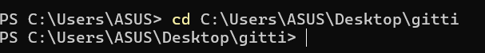
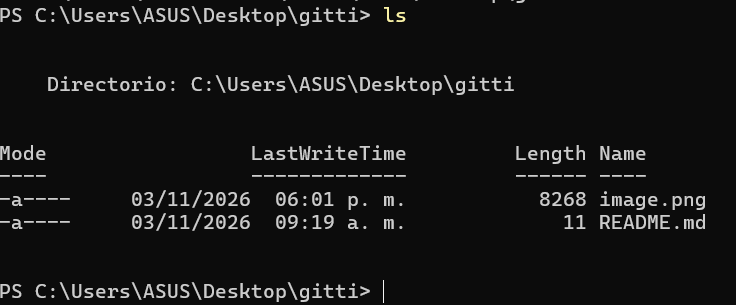
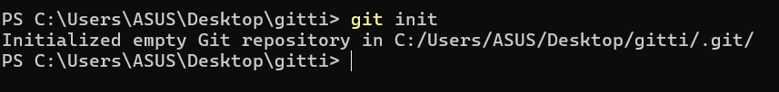
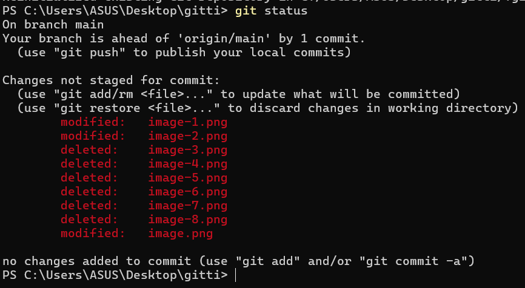

#¿Que aprendi del curso?
En este curso aprendí a usar Git y GitHub para gestionar proyectos, guardar cambios con commits, trabajar con ramas y subir repositorios a la nube. Me pareció útil porque ayuda a organizar mejor el código y facilita el trabajo en equipo.

#¿Que comandos utilizaste?
cd para localizar la carpeta

ls para navegar por la carpeta

git para inicializar el repositorio

status para revisar el estado de los archivos

